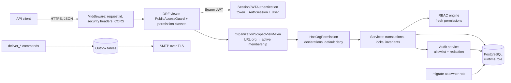

# AEMS — Phase 1 Final Report

| | |
|---|---|
| **Phase** | 1 — Backend Foundation |
| **Batches** | 1–8 (Batch 8: security hardening and review) |
| **Status** | **Phase 1 Backend Foundation complete.** Batch 8 was independently reviewed and squash-merged via PR #9 as `3c3e0f20716c05f462a5228bb0e924690bbe13de`; all six post-merge CI checks passed (run 45698594699). Frontend, deployment and Phase 2 remain separate and are not part of this completion. |
| **Plan** | [`docs/phase-1-plan.md`](phase-1-plan.md) |
| **Security model** | [`SECURITY.md`](../SECURITY.md) |
| **Architecture decisions** | [ADR-0001 … ADR-0019](adr/README.md) |

---

## A. Executive summary

Phase 1 delivers the secure, multi-tenant backend foundation that the assessment and examination
domains of later phases will build on. It contains no examination, assessment, course or student
data, and no frontend, by design.

What Phase 1 provides:

- **Identity:** a custom user model with case-insensitive email identity, Argon2id passwords,
  short-lived JWT access tokens validated against server-side sessions on every request, rotating
  refresh cookies with replay detection, CSRF protection, password change and reset through a
  durable outbox, and session management.
- **Organizations and tenancy:** a shared schema with organization-scoped rows, tenant resolution
  only from the URL, and indistinguishable 404s for everything a caller may not see. Organizations
  go through a provisioning lifecycle in which the only path to `active` is acceptance of the
  initial Owner invitation.
- **Authorization:** per-organization customizable RBAC (8 permissions; Owner, Admin, Member and
  custom roles) with default deny, delegation rules, and stale-permission protection inside locked
  transactions. The **last-active-Owner invariant** holds under concurrency.
- **Invitations:** single-use, digest-stored tokens issued at send time, with identity and
  authority revalidated under locks at acceptance.
- **Audit:** mutations and their records commit atomically; the log is append-only (trigger and
  privileges) with allowlisted, redacted content; tenant and platform query APIs.
- **Infrastructure:** RFC 9457 errors, request correlation and structured logging, an atomic
  PostgreSQL rate limiter, separate owner and runtime database roles, OpenAPI contract, Docker
  images, and CI with six required checks.

**Intended security boundaries:**

1. Tenants cannot read, enumerate or modify one another's data.
2. Within a tenant, nobody acts beyond their permissions or escalates them.
3. Every active organization keeps an active Owner.
4. Credentials are revocable immediately and never stored or logged in usable form.
5. The application cannot rewrite its own audit history.
6. Production refuses insecure configuration.

Batch 8 reviewed all of these. It found and fixed ten issues (AEMS-019 to AEMS-028), the most
significant being:

- an admin privilege escalation available to non-superuser staff (AEMS-021);
- lock-order deadlocks between ownership operations (AEMS-027).

It added a cross-cutting security suite of 591 tests.

## B. Architecture

| Component | Responsibility | ADRs |
|---|---|---|
| `apps.core` | Problem Details, request context and logging, access-control primitives and system checks, pagination and filtering, health, JSON parser | 0007, 0009, 0010, 0012, 0019 |
| `apps.accounts` | User, authentication, sessions, rate limiting, password flows, reset outbox, admin | 0004, 0008, 0013, 0014 |
| `apps.organizations` | Organizations, memberships, tenancy base and scoping, platform APIs, invitations and their outbox | 0003, 0015, 0018 |
| `apps.rbac` | Permission catalog and registry, roles, assignments, engine, ownership invariant | 0005, 0017 |
| `apps.audit` | Audit model and trigger, services, redaction, privileges, APIs | 0006, 0016 |

- **Stack:** Python 3.13, Django 5.2 LTS, DRF 3.18, SimpleJWT, psycopg 3, PostgreSQL 16 or 17.
- **Tooling:** uv, ruff, strict mypy, pytest, bandit, pip-audit, detect-secrets.
- **Images:** multi-stage Docker images (non-root production image with a health check).

**Lock order (global):** user → organizations (ascending id) → memberships (ascending id) → roles →
invitations. User and organization rows are locked `FOR NO KEY UPDATE`.

## C. Requirements traceability

| Requirement (plan §) | Implementation | Tests (evidence) | Limitations |
|---|---|---|---|
| Case-insensitive email identity (§4.1) | `accounts.normalization`, `Lower(email)` unique constraint | `accounts/tests/test_user_model.py`; reset normalization in `security/test_password_reset_attacks.py` | — |
| JWT + server-side sessions, immediate revocation (§4.2, §4.4) | `accounts.tokens`, `accounts.sessions`, `SessionJWTAuthentication` | `accounts/tests/test_tokens_and_authentication.py`; `security/test_authentication_attacks.py` (forgery, claims, lifecycle) | — |
| Refresh rotation, replay detection, concurrency (§4.2) | `sessions.rotate` (row lock, compare-and-swap) | `accounts/tests/test_refresh_rotation_and_csrf.py`; concurrent refresh in `security/test_authentication_attacks.py` | Loser of a concurrent refresh revokes the session (secure default; frontend must coordinate tabs) |
| CSRF on cookie endpoints (§4.3) | `accounts.csrf.enforce_csrf` | CSRF, origin and cookie tests in both suites | — |
| Abuse protection (§4.5) | `accounts.ratelimit` (atomic upsert), backoff | `accounts/tests/test_login_and_rate_limits.py`; `security/test_rate_limiting.py` | Fixed windows; no global limit |
| Password reset without enumeration (§4.4, §8) | Outbox (ADR-0014), generic 202 | `accounts/tests/test_password_reset_outbox.py`; `security/test_password_reset_attacks.py` | Not constant time |
| Invitation acceptance (§4.6) | `organizations.invitations` | `organizations/tests/test_member_invitations.py`, `test_onboarding.py`, `test_invitation_concurrency.py`; `security/test_invitation_attacks.py` | Historical role links (approved) |
| Tenant isolation layers 1–7 (§5.2) | `scoping`, `tenancy`, `HasOrgPermission` | `organizations/tests/test_tenant_isolation.py`, `test_tenant_immutability.py`; `security/test_tenant_isolation_matrix.py`, `test_route_policy.py` | No RLS (Phase 2 decision) |
| Provisioning lifecycle (§5.3) | `create_organization` + initial Owner acceptance | `organizations/tests/test_onboarding.py`; provisioning tests in `security/test_invitation_attacks.py` | Reactivation unavailable |
| RBAC model, engine, default deny (§6.1–6.2) | `rbac.registry`, `models`, `engine` | `rbac/tests/*`; `security/test_rbac_owner_security.py`, `test_route_policy.py` | Platform RBAC deferred |
| Ownership invariant under concurrency (§6.3) | `rbac.services` + `assert_deactivation_keeps_owners` | `rbac/tests/test_concurrency.py`; stress test in `security/test_rbac_owner_security.py` (AEMS-027) | — |
| Escalation rules, stale permissions (§6.4) | Delegation and Owner-only checks after fresh reload | `rbac/tests/test_members_and_ownership.py`, `test_roles_api.py`, `test_concurrency.py`; `security/test_rbac_owner_security.py` | — |
| Audit atomic, append-only, redacted (§7) | `audit.services`, trigger, grants, `redaction` | `audit/tests/*`; `security/test_audit_integrity.py`, `test_database_safeguards.py` | Owner/superuser can bypass; no hash chain |
| API controls (§8) | Allowlist + guard + checks; Problem Details; body limits | `core/tests/*`; `security/test_input_validation.py`, `test_route_policy.py` | — |
| Production hardening (§8) | `settings/production.py`, `validation.py` | `config/tests/test_production_settings.py`; `security/test_production_settings_hardening.py`; CI deploy check | No deployment |
| CI (§12) | `.github/workflows/backend-ci.yml` | Six checks on every PR and push | Branch protection is the owner's decision |

## D. API inventory

All routes are classified in `backend/tests/security/test_route_policy.py`. CI fails if a route is
added without a classification.

| Class | Routes |
|---|---|
| Health (plain Django) | `GET /health/live/`, `GET /health/ready/` |
| Docs (404 unless enabled; production forces off) | `/api/schema/`, `/api/docs/`, `/api/redoc/` |
| Public | `GET /api/v1/`; `GET /api/v1/auth/csrf/`; `POST /api/v1/auth/login/`, `token/refresh/` (cookie + CSRF), `logout/`, `password/reset/`, `password/reset/confirm/` |
| Token-scoped public | `GET /api/v1/invitations/{token}/`, `POST /api/v1/invitations/{token}/accept/` |
| Authenticated (own data) | `GET, PATCH /api/v1/auth/me/`; `POST /auth/password/change/`; `GET /auth/sessions/`; `DELETE /auth/sessions/{id}/`; `POST /auth/sessions/revoke-others/`; `GET /api/v1/organizations/` |
| Tenant | `GET` (`organization.view`) and `PATCH` (`organization.update`) on `/organizations/{org_id}/`; `GET me/` (any active member); `GET audit-logs/` (`audit.view`); `GET members/` and `members/{id}/` (`members.view`); `PATCH`, `DELETE members/{id}/` and `PUT members/{id}/roles/` (`members.manage`); `GET roles/`, `roles/{id}/` and `permissions/` (`roles.view`); `POST roles/`, `PATCH`, `DELETE roles/{id}/` (`roles.manage`); `GET`, `POST invitations/` and `POST invitations/{id}/revoke/` (`invitations.manage`) |
| Platform (staff + model permission) | `GET, POST /api/v1/platform/organizations/`; `GET, PATCH …/{id}/`; `GET, POST …/{id}/initial-owner-invitation/`; `POST …/revoke/` (`manage_initial_owner_invitation`); `GET /api/v1/platform/audit-logs/` (`audit.view_auditlog`) |
| Admin | `/<DJANGO_ADMIN_URL>` (staff session; own rate-limited login) |
| Operations | `manage.py deliver_password_reset_emails`, `deliver_invitation_emails`, `purge_auth_rate_limits`, `verify_runtime_privileges`, `verify_no_default_tables` |

## E. Security verification

**Methodology (Batch 8).** For each area:

1. Identify the intended boundary.
2. Read the code and the existing tests.
3. Write adversarial tests for plausible failure modes against real PostgreSQL, using HTTP
   requests, raw SQL as the runtime role, and barrier-synchronized threads.
4. Reproduce suspected issues before fixing them.
5. Add permanent regression tests.

An independent read-only code review of the outboxes, audit, admin, core API and serializers ran
in parallel. Each claim it made was verified against the code, and reproduced where possible,
before being accepted.

| Priority | Coverage | Result |
|---|---|---|
| 1. Authentication bypass | Forged, unsigned and `alg`-confused tokens; malformed or missing claims; issuer and audience; cross-user `sid`; revoked sessions and deactivated users; garbage credentials on every protected route | No bypass found |
| 2. Privilege escalation | Self-promotion, shared-role promotion, delegation, Owner-only rules, platform versus tenant authority, **admin** | **AEMS-021 found and fixed**; RBAC itself sound |
| 3. Cross-tenant disclosure | Every caller category × every tenant endpoint; foreign nested and body ids; listing; audit filters and cursors | No disclosure; AEMS-020 (cursor robustness) fixed |
| 4. Loss of the last Owner | Pairwise races (Batch 6) plus a six-way stress test across two organizations | Invariant always held; **AEMS-027 deadlocks fixed** |
| 5. Token and secret leakage | Logs, responses, audit rows, outbox rows and admin pages scanned for raw tokens, digests, passwords and JWTs | No leakage; AEMS-023 (console email) fixed |
| 6. Concurrent authorization | Stale permissions, delivery workers, revocation versus delivery, acceptance versus role deletion, refresh, reset consumption | Sound; AEMS-024 (crash re-delivery) fixed |
| 7. Audit integrity | Required events, rollback on audit failure, no false success, injection, runtime-role SQL | Sound; AEMS-022 and AEMS-025 fixed |
| 8. Production misconfiguration | Settings snapshot, refusals, `check --deploy` | AEMS-023 and AEMS-026 fixed |

The findings and fixes are detailed in [ADR-0019](adr/0019-phase-1-security-hardening.md). The
historical findings AEMS-001 to AEMS-018 were resolved in Batches 1–7.

## F. Database integrity

- **Migrations:** 11 application migrations across accounts (2), organizations (4), rbac (3) and
  audit (2), plus a test-only fixture app.
  - Every migration declares itself reversible. The organizations, RBAC and audit schema is rolled
    back to zero and reapplied in `test_database_safeguards.py`.
  - Upgrade tests exist for Batch 5 to 6 and Batch 6 to 7.
  - Drift is checked in CI under both settings modules.
- **Constraints:**
  - Case-insensitive unique email.
  - One membership per user and organization.
  - Unique `(id, organization_id)` keys, with composite foreign keys from role assignments and
    invitation roles, so cross-tenant links are impossible.
  - Role, organization, audit and invitation format and state checks.
  - One pending invitation per address and organization; one pending initial-Owner invitation.
- **Triggers:**
  - `audit_auditlog_append_only` (no update or delete for any role).
  - `rbac_permission_protect` (immutable codes, no deletes).
  - `organizations_invitation_protect` (only pending rows change; identity columns immutable; no
    deletes).
- **Privileges:**
  - The runtime role owns nothing and holds only `SELECT, INSERT` on the audit table.
  - It cannot alter, drop or disable triggers, change `session_replication_role`, create objects or
    roles, or grant privileges.
  - This is verified in CI (`verify_runtime_privileges`) and by raw-SQL tests.

## G. Test results

The full suite always runs against PostgreSQL with both database roles, and the runtime-role tests
are required in CI.

| Measure | Value |
|---|---|
| Tests (full suite, this batch) | **2,035 passed**, 0 failed, 0 skipped (Batch 7 baseline, re-measured before the batch: 1,444) |
| New security suites (`backend/tests/security/`) | 591 tests in 13 modules |
| Branch coverage | **99.60%** (gate: 90%; Batch 7 baseline 99.56%) |
| PostgreSQL | **17.12** (`postgres:17-alpine`, two-role init script, runtime-role tests required) and 16 locally; 17 in CI |
| Static analysis | ruff (lint and format), strict mypy: clean; bandit: no issues |
| Supply chain | pip-audit: no known vulnerabilities; detect-secrets: clean |
| Contract | OpenAPI regenerated, validated, no drift |
| Deployment checks | `check --deploy --fail-level WARNING`: pass |

CI gates (all required by the `Backend CI result` job):

- Lint & type check;
- Tests & migrations;
- Security;
- API contract;
- Docker image (production image build, non-root, health, end-to-end flows through Mailpit);
- Backend CI result.

## H. Known limitations

**Deferred capabilities**, which are not defects:

- frontend;
- MFA and SSO;
- self-service signup;
- platform RBAC administration;
- `suspended → active` reactivation;
- resending an invitation without reissuing it;
- immutable historical role snapshots;
- retention and archival (recommendations in `SECURITY.md`);
- deployment, monitoring and backups.

**Residual risks** (documented, accepted for Phase 1):

| Risk | Mitigation today | Path |
|---|---|---|
| No row-level security | Single resolution point, scoped querysets, composite FKs, matrix and route meta-tests | RLS decision before Phase 2 data |
| Raw-SQL reassignment of unreferenced tenant rows | Application-level immutability; runtime-role-only access | RLS or triggers in Phase 2 |
| Database owner or superuser can rewrite audit history | Separate roles; trigger blocks even the owner unless disabled | External archival or hash chaining if required |
| Authenticated audit-volume growth | Requires a valid account; tied to the actor | Authenticated rate limits if needed |
| Fixed-window rate limits | Per IP and per account, plus backoff | Sliding windows if abuse is observed |
| At-least-once email delivery | Leases, compare-and-set, attempt bound; only the latest invitation link works | — |
| Historical invitation role links removed with deleted custom roles | Audit keeps role ids (approved) | Snapshots, if required |

**Open security findings:** none known in the reviewed scope after Batch 8.

## I. Phase 2 prerequisites

Before any assessment, examination, course, student or response data is introduced:

1. **Decide on PostgreSQL RLS** (ADR-0003, plan §5.4). The current design is prepared for it:
   - non-superuser runtime role without `BYPASSRLS`;
   - `TenantScopedModel` on every tenant table;
   - tenant context resolved in one place.

   If RLS is adopted:
   - use `FORCE ROW LEVEL SECURITY`;
   - set the context per transaction with `SET LOCAL`;
   - fail closed when the setting is absent;
   - provide audited bypasses for platform operations;
   - add RLS-specific tests.
2. **Data classification and retention** for student and examination records, together with the
   audit retention and archival policy (`SECURITY.md`).
3. **Scope-level roles** (for example per course or exam), via the nullable-scope design in ADR-0005,
   and a review of how the lock order extends to new aggregates.
4. **File storage and uploads**, if needed: new limits, scanning and storage isolation (Phase 1
   has none).
5. **Frontend security requirements** already recorded in the plan:
   - access tokens kept in memory only;
   - refresh coordinated across tabs with Web Locks;
   - CSRF header handling.
6. **Operational readiness:**
   - TLS SMTP with SPF, DKIM and DMARC;
   - scheduled delivery commands;
   - monitoring of security events;
   - backups;
   - an enabled private vulnerability-reporting channel.

## J. Final assessment

The implemented Phase 1 backend **meets its approved acceptance criteria**, on the evidence of the
test suite, the CI gates and the Batch 8 review. Every requirement in §C is implemented and tested.

Ten security findings were identified during the final review. All ten are fixed, with
regression tests that fail on the previous code. One was high severity: the admin escalation,
which required a staff account holding `accounts.change_user`.

No known security defect remains open in the reviewed scope. The residual risks in §H are
documented design limits, chiefly the absence of RLS, which must be decided before Phase 2 data
is stored.

This assessment covers code and configuration only. AEMS has not been deployed, penetration-tested
by an independent party, or certified. **Phase 1 Backend Foundation is complete:** Batch 8 was
independently reviewed and merged through PR #9. The squash-merge commit is
`3c3e0f20716c05f462a5228bb0e924690bbe13de` (one parent; tree identical to reviewed head
`089bec9f9ce3b990317a70d7c0a7046fbc76afbe`), and all six post-merge checks passed in
[CI run 45698594699](https://github.com/rahilashraf/aems-portfolio/actions/runs/45698594699).
Frontend implementation, integration, deployment, and Phase 2 have not begun; the Phase 2 RLS
decision remains a prerequisite for storing student or assessment data.
